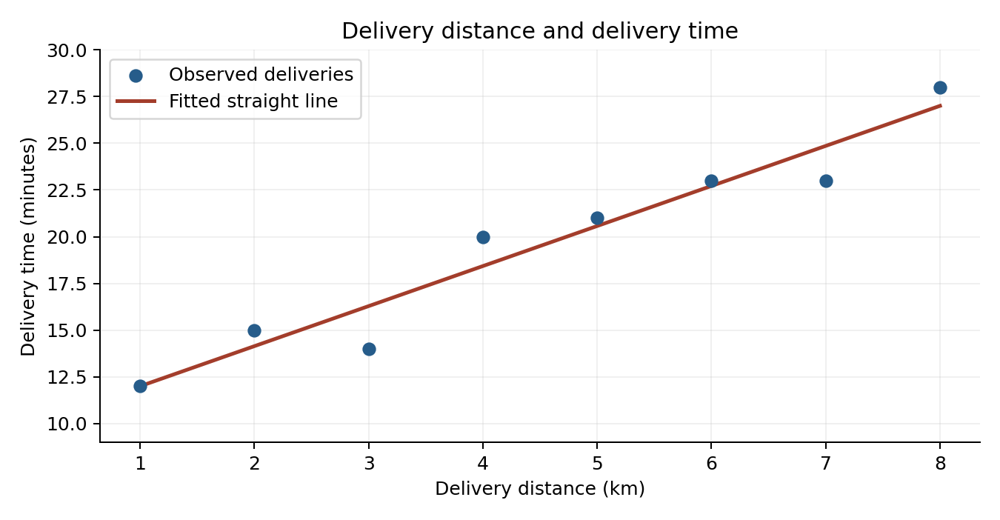
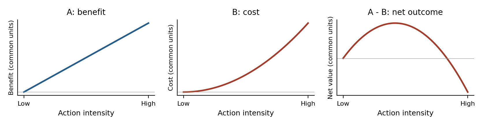
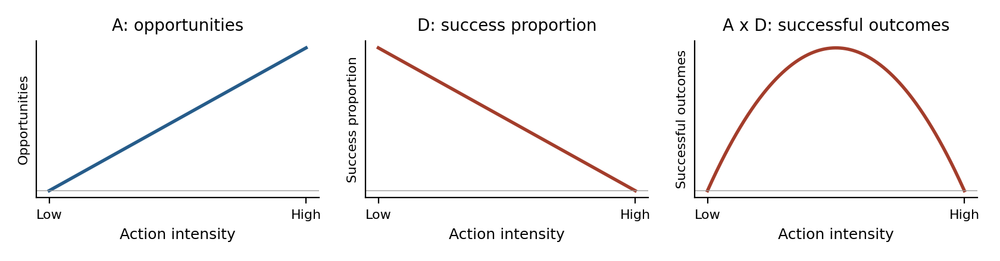

# Homework 2: Read, Explore, Calculate, and Explain

Demand Planning & Fulfillment  
**Due Saturday, October 17, 2026 · Total: 100 points · Required work: 90–120 minutes**

Short examples of how to present your answers to Questions 1 and 2 are available in **HW2_Examples.pdf** on the homework page. Use your own results and wording.

There are four questions: Questions 1–3 are required and Question 4 is optional extra credit. Begin by interpreting a provided graph (Question 1, 20 points), then upload data and fit a line in Colab (Question 2, 30 points), and finally learn the formula through AI dialogue and apply it by hand (Question 3, 50 points). No confidence intervals, hypothesis tests, or multiple regression are required.

## Question 1: Explain the provided graph — 20 points

The graph below shows **simulated teaching data** for delivery distance and delivery time. The dots are eight observed deliveries; the straight line is their least-squares fitted line. Use the graph and small regression table to explain the relationship in your own words. You do not need Colab or a new analysis for this question.

| Term | Coefficient |
| --- | ---: |
| Intercept | 9.857 |
| Distance (km) | 2.143 |

- What does the graph suggest about distance and delivery time? Explain the slope using its units.
- What is the difference between a dot and the line? Choose a dot above or below the line and explain what that position means.
- What could a delivery planner use this line for, and what should they avoid concluding from it? Explain one limitation visible in the graph or implied by these data.

## Question 2: Upload, prompt, and fit a line in Colab — 30 points

Find a CSV dataset that interests you, or download **one** of the original files below. Choose one numerical X and one numerical Y. Analyze only one dataset for this question.

| Original CSV | A row represents | Suggested X | Suggested Y |
| --- | --- | --- | --- |
| `tips.csv` | A restaurant bill | `total_bill` (dollars) | `tip` (dollars) |
| `mpg.csv` | A car model | `weight` (pounds) | `mpg` (miles per gallon) |
| `penguins.csv` | A penguin | `flipper_length_mm` (mm) | `body_mass_g` (grams) |

The CSV files listed above are ready to download from the homework page. Choose one, save it on your computer, and upload it to Colab. If you find your own data, include its source link.

Create a **blank Google Colab notebook** and upload the raw CSV yourself. Write your own prompts to Colab's AI assistant to read the file, fit a simple linear regression with an intercept, and display a regression table and a scatterplot with the fitted straight line. Request the intercept, slope, observation count, and R-squared. Ask for clearly labeled axes with units and no confidence band.

Include screenshots of the uploaded filename, your actual prompts, regression table, and graph. Explain in your own words:

- What question are you asking, what does one row mean, and why did you choose X and Y?
- Why did you write your prompts that way? What did the AI do to turn your uploaded data into the table and line? Explain any follow-up you needed.
- How do the slope, intercept, and line relate to the fitted-line idea in Question 1 and the formula you will investigate in Question 3? Explain what the slope and R-squared mean for your data.
- Choose one specific statement in the AI's explanation. Do you agree, partly agree, or disagree? Refer to your table or graph to explain why. A correct statement is acceptable if you explain why it is correct.

### Colab starting steps

1. Download and, if necessary, unzip your CSV. Open [Google Colab](https://colab.research.google.com/), sign in, and create a new notebook.
2. Open the Gemini / AI chat using its spark icon. Attach the CSV through the chat's upload control and check the filename. Alternatively, upload through the Files panel and tell the AI the filename and runtime path shown there.
3. Write your own prompts. First check that the AI can read the correct file and show its columns; then ask for the analysis you need.
4. Review and run its proposed analysis or generated code cells to obtain actual output. Check the selected variables and labels, and follow up if something is wrong. Take screenshots of the results.

No ready-made regression notebook is supplied. If AI chat is unavailable, contact the instructor for help. No paid upgrade is required.

## Question 3: How can I calculate a best-fit line myself? — 50 points

**Open learning question:** If I want a formula for the best-fit straight line, rather than asking a computer to draw it for me, how can I calculate that line? How does the formula work, and why does it make sense?

### Learn through your own prompts

Use an AI assistant of your choice to learn the formula and method for a simple least-squares best-fit line with an intercept. Start with your own question and continue the conversation until you understand how to use the formula. Ask follow-up questions about anything you do not understand. There is no prescribed wording or required number of prompts.

Show the conversation that explains how you learned: include screenshots or a transcript of your actual prompts and the relevant AI replies. Explain **why you asked those questions**, what you learned from the replies, and how a follow-up helped resolve confusion or check your understanding. A pasted conversation by itself is not an answer. Write the formula you learned and explain its symbols and steps in your own words. You do not need to derive it using calculus.

### Apply your understanding by hand

Use these **five simulated teaching observations**. X is the number of workers on a shift; Y is the number of orders processed per hour.

| Observation | X: workers | Y: orders per hour |
| --- | ---: | ---: |
| A | 1 | 4 |
| B | 2 | 4 |
| C | 3 | 7 |
| D | 4 | 8 |
| E | 5 | 12 |

**Handwrite your calculation of the slope, intercept, and fitted equation.** Show your intermediate arithmetic so someone can follow how you used the formula. Explain how your calculation corresponds to the method you learned in the AI conversation.

On paper, draw and label the axes, plot all five observations, and **use a ruler to draw your calculated fitted straight line**. Show how you calculated two points on the line to position it. Do not connect the five observed dots to one another. A basic calculator may be used for arithmetic, but do not use AI or a regression program to calculate these five observations or produce this graph for you.

### Explain and evaluate the method

In your own words, explain what you think “best fit” means and what the formula is trying to achieve. Drawing on the class discussion, why is this a relatively reasonable way to choose a line? What problem does it solve that a less careful way of choosing or judging a line might create? Do you think this method is always reasonable? Explain at least one limitation or situation where you would question it, and give your reason. Also explain what your hand-drawn line says about these workers and orders.

## What to submit

Submit a **Word document or clear scans/photos of handwritten answers**, with your AI learning conversation, actual prompts, screenshots, and your own explanations. **Question 3's calculations and ruler-drawn graph must be handwritten**, even if the rest is typed. Include answers to Questions 1–3; add Question 4 if you choose the extra credit. Copied AI explanations or screenshots alone are incomplete. No code or notebook submission is required.

Colab guidance: [official Colab FAQ](https://research.google.com/colaboratory/faq.html).

## Question 4: One action, two sides — optional extra credit

**Reward:** completing this optional question satisfactorily multiplies your score on Questions 1–3 by **1.05**. For example, 80 becomes 84. Allow about 15–20 additional minutes. No regression calculation is required.

A managerial action can help in one way and hurt in another. The diagrams show two ways those effects can combine to produce an inverted U: the outcome first rises and then falls. These are conceptual teaching curves, not measured data. The shapes and relative changes matter; subtraction or multiplication alone does not guarantee an inverted U.

### Route 1: Subtract a cost from a benefit — A − B

**What subtraction means:** take a benefit and deduct a cost measured in the same units. For example, training may create productivity savings but also cost money and take time away from service. Convert both to dollars over the same period to discuss net value. If added costs eventually grow faster than added benefits, the net outcome can rise and then fall.

### Route 2: Multiply opportunities by a success proportion — A × D

**What multiplication means:** opportunities produce results only to the extent they succeed. For example, customers reached × the proportion who buy gives the number of buyers. More aggressive outreach might reach more people but reduce the proportion who buy. The product can eventually fall if the lower success proportion more than offsets the greater reach. These factors are not a benefit and cost that can simply be subtracted.

### Why we still need evidence

Opposing effects do not guarantee a visible inverted U. If the benefit grows much faster than the cost, the net outcome may keep rising throughout the observed range; if the cost dominates, it may keep falling. For A × D, rapid growth in opportunities can outweigh a small fall in the success proportion. Similar opposing changes may leave the outcome almost flat.

For example, training benefits could continue to outweigh costs over every training level in our data, even if costs would dominate at much higher levels. The peak would lie outside the observed range, so we would see only the rising side. A different sample might cover only the falling side. Curves can also be shallow, steep, or too weak relative to the noise to see clearly. “Nearly flat” does not by itself mean the two mechanisms are absent.

This is why the management story is a prediction to investigate with actual data: we need evidence about the relative strengths, shape, peak location, and range we observe. We cannot establish a nonlinear relationship simply by guessing that an action has both good and bad effects.

### Your two management examples

Give **one example for A − B and one for A × D**, preferably different from the illustrations above. For each, explain in your own words:

- What action are we increasing, and what outcome do we care about? Identify the two sides and what A and B, or A and D, mean, including units.
- Why does subtraction or multiplication make sense in your example? Explain the operation, not just the symbols.
- Why could the outcome improve at first but worsen when we do too much? Explain both parts of the curve and the assumptions your prediction needs. What could instead make the observed relationship rise, fall, or look nearly flat?

Finally, explain why considering a nonlinear relationship is useful for a manager here. What would a straight-line “more is always better” or “more is always worse” story miss? Your examples are reasoned predictions, not claims that an inverted U has already been proven. Add your answer to your usual submission.

The original teaching diagrams use the mechanism framework discussed by [Haans, Pieters, and He (2016), Thinking about U](https://doi.org/10.1002/smj.2399). Reading the paper is not required.
